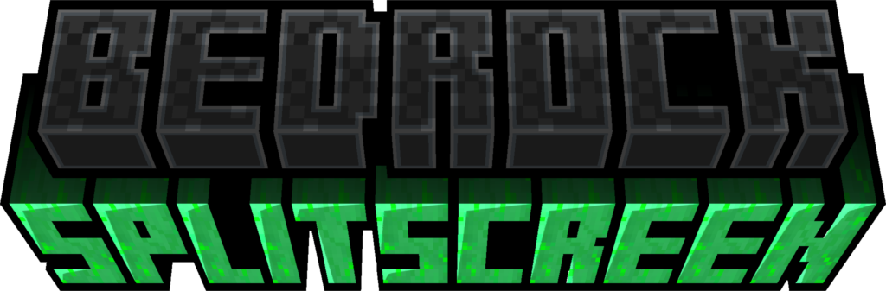
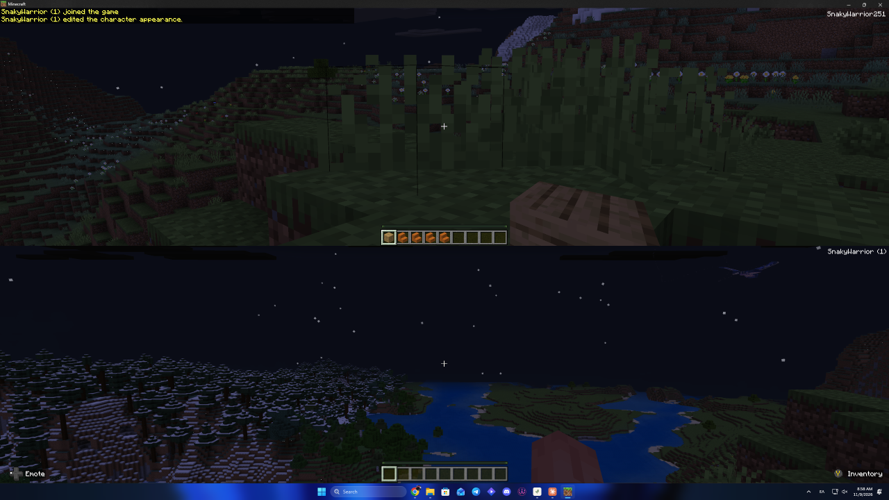

<p align="center"></p>

# SplitScreenMod

Local split-screen for **Minecraft Bedrock on Windows**: up to 4 players on one PC, each with their own controller.

Minecraft Bedrock already contains split-screen (it is used on Xbox), but the Windows version switches it off. This [LeviLamina](https://github.com/LiteLDev/LeviLamina) mod switches it back on.



## Features

- **Choose who plays.** Press start on a free controller and a menu opens in the middle of the screen: play as player 1, as one of your saved local players (each keeps their own inventory), or take over a player whose controller was lost. Every player is shown with the face of their skin. Nobody joins until you choose.
- **Asks again in every world.** Controllers do not keep their player from the last world: after you enter a world, each controller asks who is playing.
- **One controller per player.** A controller that reconnects takes the place of a player who lost theirs and asks who should play.
- **Player 1 keeps keyboard and mouse.** In a world, a controller only controls player 1 when you pick player 1 in the menu.
- **Players leave on their own:** a player (2 to 4) whose controller stays disconnected for 20 seconds is removed. The game's "Controller lost connection" prompt counts down the seconds.
- **Split screen menu:** a **Split screen** button in the pause menu (or **Y** on a controller, or **F7**) switches between top-and-bottom and side-by-side, and removes players.
- **Three players fill the screen:** three equal parts instead of four quarters with one left black.
- **Made to survive updates.** The mod finds the places it needs by the shape of the game code, not by fixed addresses, so a new game version normally needs only a rebuild against the matching LeviLamina.

## Requirements

| | |
|---|---|
| Game | Minecraft Bedrock for Windows (Microsoft Store / Xbox app) **1.26.60** |
| Mod loader | LeviLamina **26.60.x** (client). The easiest way to get it is through [LeviLauncher](https://github.com/LiteLDev/LeviLauncher) |
| Controllers | One per extra player. Xbox, PlayStation, Switch Pro and other gamepads that Windows supports |

## Installation

1. Install [LeviLauncher](https://github.com/LiteLDev/LeviLauncher) and create a game instance with LeviLamina.
2. Download `SplitScreenMod-client-windows-x64.zip` from the [latest release](../../releases/latest).
3. Extract the zip into a new folder `mods\SplitScreenMod\` inside your instance folder, for example `%LocalAppData%\LeviLauncher\Instances\1.26.60.05\mods\SplitScreenMod\` (older LeviLauncher versions use `%AppData%\levilauncher.exe\versions\...`). The folder must contain `manifest.json` and `SplitScreenMod.dll` directly, not inside another folder.
4. Start the game from LeviLauncher.

## How to play

1. Start the game and enter a world (with keyboard and mouse, or a controller).
2. Press start on another controller. A menu opens in the middle of the screen: pick who plays with it. Use the D-pad or stick and **A**, the arrow keys and **Enter**, or the mouse. **B** or **Esc** closes it.
3. Repeat for players 3 and 4.
4. In the pause menu, click **Split screen** (or press **Y** on a controller, or **F7**) to switch the split or remove a player.

To leave, remove the player in the Split screen menu, or unplug or switch off that controller: the "Controller lost connection" prompt counts down, and after 20 seconds the player is removed. Plug a controller back in before that to pick up a player again.

## Troubleshooting

The mod writes a log to `mods\SplitScreenMod\splitscreen.log`. If controllers go to the wrong player, press **F9** in the game first: it writes which controller belongs to which player into the log. Please attach the log when you [report a problem](../../issues/new/choose).

<details>
<summary>Advanced: splitscreen.cfg</summary>

For testing after a game update, you can put a `splitscreen.cfg` file next to the mod to override which callers get split-screen:

```
hook allowSplitScreen auto              # default
hook allowSplitScreen trace             # log every caller, change nothing
hook allowSplitScreen force 876204 ...  # allow only these call sites (offsets in Minecraft.Windows.exe)
```

</details>

## Building

You do not need Visual Studio. Every push is built by GitHub Actions; download the build from the Actions tab. To build locally, install [xmake](https://xmake.io) and run:

```
xmake f -a x64 -m release -p windows --target_type=client -y
xmake
```

## Licence

[GPL-3.0](LICENSE) © SnakyWarrior. This mod is not affiliated with Mojang or Microsoft.
