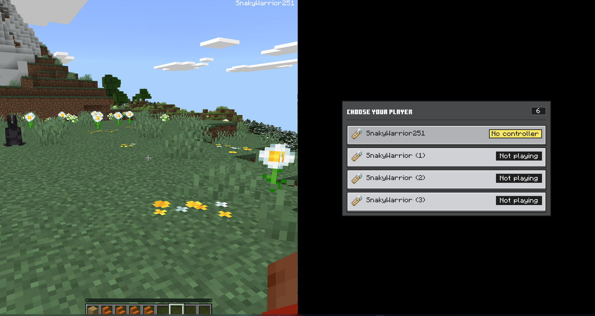
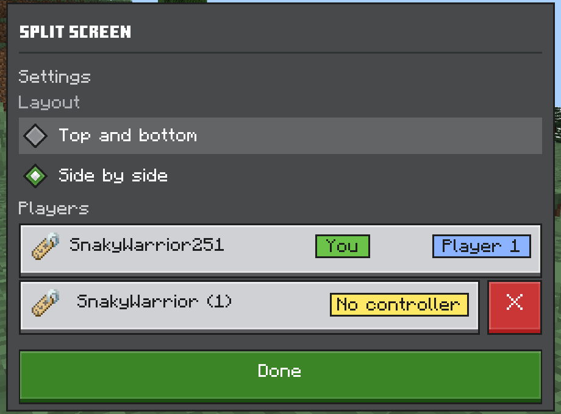
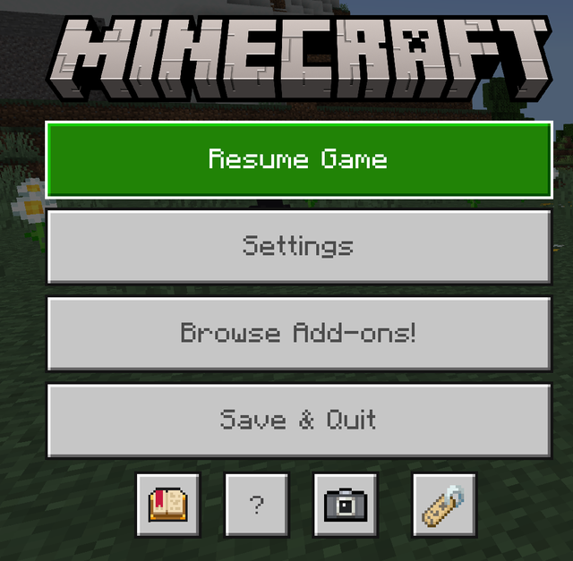

<p align="center"></p>

# SplitScreenMod

Local split-screen for **Minecraft Bedrock on Windows**: up to 4 players on one PC, each with their own controller.

Minecraft Bedrock already contains split-screen (it is used on Xbox), but the Windows version switches it off. This [LeviLamina](https://github.com/LiteLDev/LeviLamina) mod switches it back on.

<p align="center"><a href="https://www.patreon.com/PantelisKonstantinidis"></a></p>


## Features

- **Choose who plays.** Press start on a free controller: the screen splits and the new player's part stays black with a menu until you choose a saved local player (each keeps their own inventory), player 1, or a player whose controller was lost. The menu closes by itself after 10 seconds.
- **Split screen menu.** The name tag button in the pause menu opens it: pick the layout (top and bottom or side by side), take another player's place, remove a player, or take player 1's controller away so it can choose another player.
- **Looks like the game's new UI.** Every player has a P1-P4 picture in their own colour, and tags show who is playing, who has no controller and who you are.
- **Player 1 keeps keyboard and mouse.** A controller only plays as player 1 when you choose that. A controller that is already connected when you enter a world waits for you to press start.
- **One controller per player.** A controller that reconnects can pick up the player who lost theirs. A player whose controller stays disconnected for 20 seconds leaves; the game's "Controller lost connection" prompt counts down the seconds.
- **In your language.** The menus follow the game's language: English, Greek, Chinese (simplified and traditional), Japanese, Korean, German, French, Spanish, Portuguese, Russian, Ukrainian, Italian, Polish and Turkish.
- **Made to survive updates.** The mod finds the places it needs by the shape of the game code, not by fixed addresses, so a new game version normally needs only a rebuild against the matching LeviLamina.

## Screenshots

**A new controller chooses who plays.** The screen splits, and the new player's part stays black with this menu until you pick someone (it closes by itself after 10 seconds):



**The Split screen menu**, from the pause menu: the layout, the players with their status, swapping places, removing a player (X):

<p align="center"></p>

**The name tag button** in the pause menu opens it:

<p align="center"></p>

## Requirements

| | |
|---|---|
| Game | Minecraft Bedrock for Windows (Microsoft Store / Xbox app) **1.26.60** |
| Mod loader | LeviLamina **26.60.5** or a later 26.60 version (client). The easiest way to get it is through [LeviLauncher](https://github.com/LiteLDev/LeviLauncher) |
| Controllers | One per extra player. Xbox, PlayStation, Switch Pro and other gamepads that Windows supports |

## Installation

**Easiest:** in [LeviLauncher](https://github.com/LiteLDev/LeviLauncher), open your instance's **Manage Mods**, press **Import .mcmod** and pick `SplitScreenMod.mcmod` from the [latest release](../../releases/latest).

**By hand:**

1. Install [LeviLauncher](https://github.com/LiteLDev/LeviLauncher) and create a game instance with LeviLamina.
2. Download `SplitScreenMod-client-windows-x64.zip` from the [latest release](../../releases/latest).
3. Extract the zip into a new folder `mods\SplitScreenMod\` inside your instance folder, for example `%LocalAppData%\LeviLauncher\Instances\1.26.60.05\mods\SplitScreenMod\`. The folder must contain `manifest.json`, `SplitScreenMod.dll` and the `resource_packs` folder directly, not inside another folder.
4. Start the game from LeviLauncher.

## How to play

1. Start the game and enter a world (with keyboard and mouse, or a controller).
2. Press start on another controller. The screen splits and that player's part shows a menu: pick who plays with that controller.
3. Repeat for players 3 and 4.
4. In the pause menu, press the name tag button under Save & Quit to change the layout, swap or remove players.

To leave, press the red X next to the player in the Split screen menu, or unplug or switch off that controller: the "Controller lost connection" prompt counts down, and after 20 seconds the player is removed. Plug a controller back in before that to pick up the player again.

## Troubleshooting

The mod writes a log to `mods\SplitScreenMod\splitscreen.log`; the run before is kept as `splitscreen.prev.log`, so after a crash attach that one. If controllers go to the wrong player, press **F9** in the game first: it writes which controller belongs to which player into the log. Please attach the log when you [report a problem](../../issues/new/choose).

## Building

You do not need Visual Studio. Every push is built by GitHub Actions; download the build from the Actions tab. To build locally, install [xmake](https://xmake.io) and run:

```
xmake f -a x64 -m release -p windows --target_type=client -y
xmake
```

## Support

The mod is free and stays free. If it gives you split-screen nights you would not have had, you can support its development on [Patreon](https://www.patreon.com/PantelisKonstantinidis). Bug reports and ideas on the [issues page](../../issues) help just as much.

## Licence

[GPL-3.0](LICENSE) © SnakyWarrior. This mod is not affiliated with Mojang or Microsoft.

The menu colours and the cross icon come from [Spectrollay-OreUI](https://github.com/Spectrollay-OreUI/OreUI) (MIT, © 2020 Spectrollay). The Ore UI button and radio textures come from [bedrock-core/ui](https://github.com/bedrock-core/ui) (MIT, © 2026 bedrock-core; licence in `resource_packs/SplitScreenUI/textures/ui/ore-styled/`).
